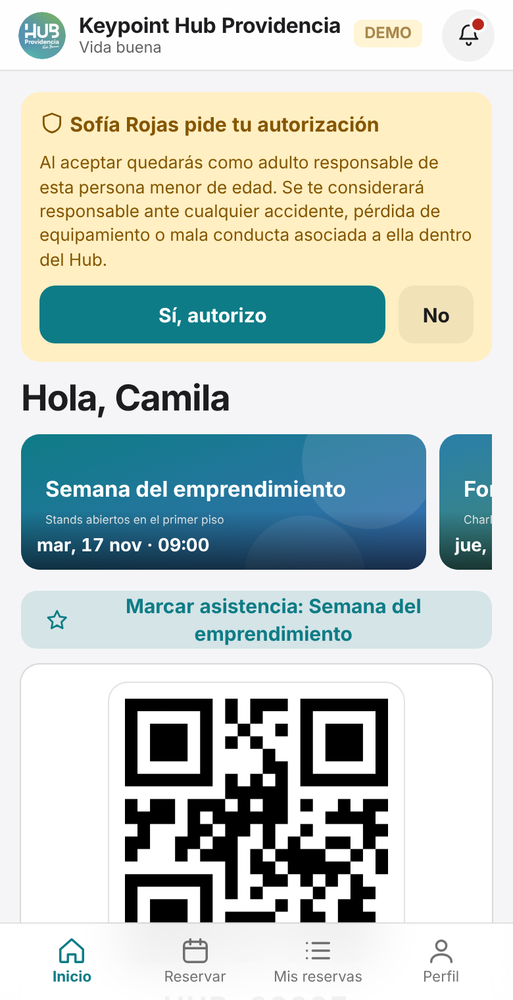
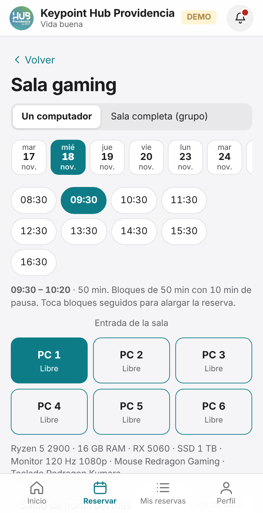
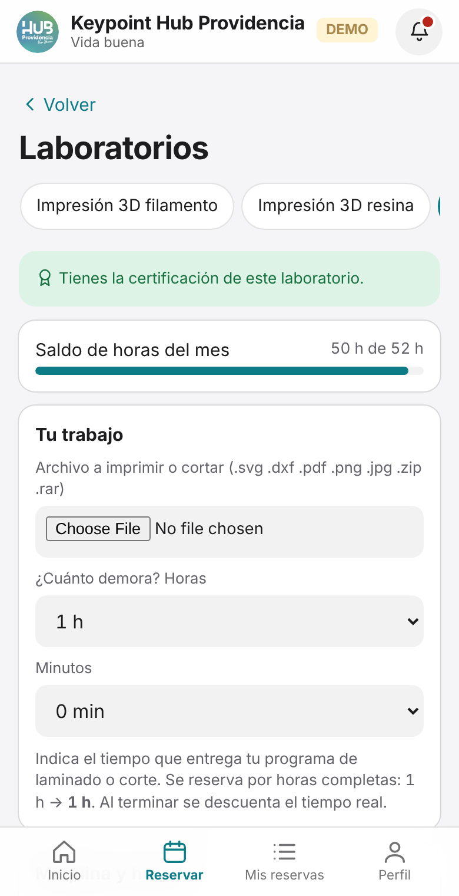
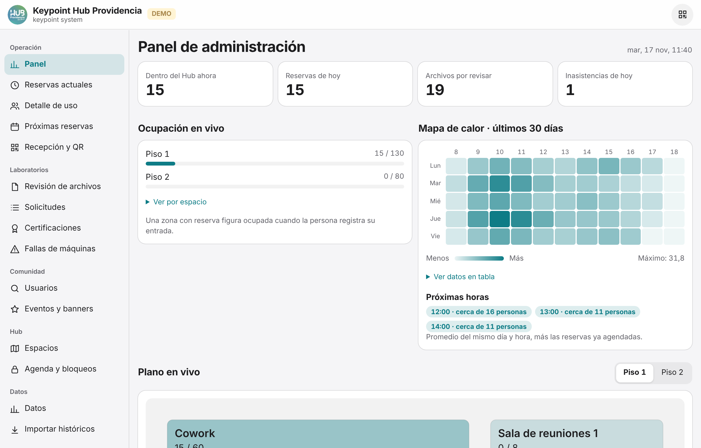
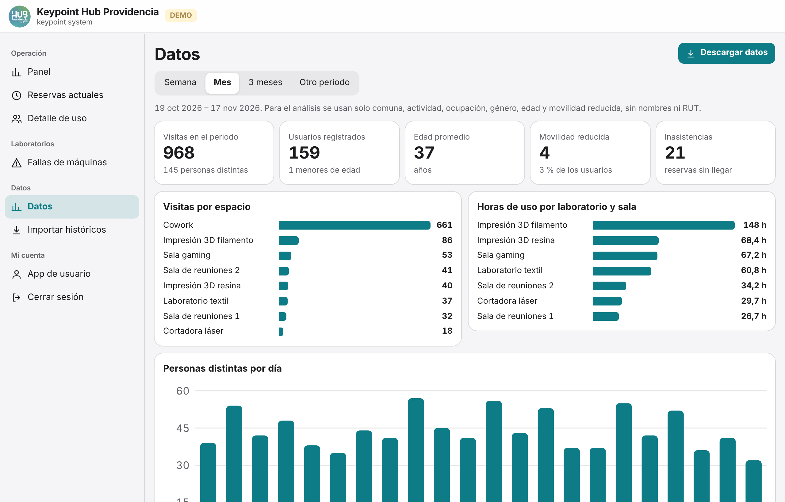

# Informe Capstone · Segunda entrega

## ¿Cómo podríamos automatizar el sistema de registro y reserva de espacios del edificio del Hub Providencia?

**Equipo:** keypoint

**Integrantes:** Constanza Martinez, Maite Martinez, Cesar Aravena, Diego Donoso, Roderick Grez

**Docente:** Ricardo Andrés Sepúlveda

**Asignatura:** Proyecto Capstone

**Fecha:** 17 de noviembre de 2026

## Índice

1. Portada y resumen
2. Problema y necesidad
3. Propuesta de solución
4. Uso e implementación
5. Diseño técnico
6. Prototipo o piloto
7. Plan de trabajo
8. Supuestos, riesgos y limitaciones
9. Referencias bibliográficas
10. Anexos

## 1. Portada y resumen

**Resumen**

El Hub Providencia es un espacio municipal de cowork, laboratorios de fabricación digital y eventos que hasta ahora registra el ingreso de personas y la reserva de espacios con herramientas separadas: un libro, correos, planillas, formularios de Google y un panel de Power BI que reúne los datos sin depurarlos. El resultado es una carga administrativa alta, reservas de laboratorio que tardan desde horas hasta semanas en confirmarse y datos que no permiten saber con certeza quién usa cada espacio.

Esta segunda entrega amplía el informe anterior con las respuestas de la administración del Hub y con el sistema ya construido. Desarrollamos **Keypoint Hub Providencia**, una aplicación web que reúne en una sola plataforma el registro de usuarios con una credencial QR, el control de entradas y salidas en recepción, la reserva de salas de reuniones, equipos de la sala gaming y máquinas de laboratorio, las certificaciones, las penalizaciones, los eventos y un panel de datos para la administración. El sistema separa una app para usuarios y otra para el equipo del Hub, con permisos por credencial (recepción, encargado de laboratorio, administración y analista de datos).

La reserva de laboratorios queda automatizada: se confirma en el momento si la persona tiene la certificación, saldo de horas y el horario está libre, y al encargado solo le queda revisar el archivo. La recepción puede trabajar sin internet y sincronizar después. La solución se entrega como código listo para publicar en GitHub, con una demostración en línea con datos de ejemplo, un servidor con base de datos PostgreSQL para el uso real, un manual y cinco trípticos de introducción por cargo.

Los resultados del piloto quedan pendientes: a la fecha de este informe el sistema está construido y probado por el equipo, pero aún no se ha usado con personas reales en el Hub.

## 2. Problema y necesidad

### 2.1 Delimitación del problema

El edificio del Hub Providencia tiene dos pisos. En el primero están el cowork, de uso libre, la recepción y dos salas de reuniones (para 8 y 10 personas). En el segundo están la sala gaming con seis computadores, los laboratorios (impresión 3D de filamento, impresión 3D de resina, cortadora láser y textil), un auditorio de unas 60 personas y las residencias para pymes, con 30 cupos. La administración estima un aforo cercano a 130 personas en el primer piso y 80 en el segundo, y la distribución interior cambia según la época.

Cada espacio se gestiona con un mecanismo distinto:

- **Laboratorios.** El usuario envía por correo el archivo a imprimir o cortar. El encargado estima el tiempo con el software de cada máquina y propone bloques. Para pedir una hora la persona debe estar registrada y haber aprobado la certificación del laboratorio. El proceso tarda desde horas hasta semanas y depende de una sola persona.
- **Cowork.** Es libre y sin reserva, pero cada visita obliga a llenar un formulario de Google completo, lo que toma entre 2 y 10 minutos. Parte de las personas no se registra y no hay forma de saber si hay puestos antes de llegar.
- **Salas de reuniones.** Se piden en persona en el mesón, sin agenda ni límites de tiempo.
- **Sala gaming y residencias.** Se anotan en un libro con hora, nombre, emprendimiento y firma.
- **Eventos y certificaciones.** Hay unas dos charlas diarias de 50 a 150 asistentes y certificaciones semanales. Las inscripciones van por formularios separados.

El problema central es la descentralización: cada equipo trabaja en sus propias planillas, los datos se asignan a mano y el consolidado en Power BI no está limpio. Recepción atiende alrededor de 100 personas al día con este esquema.

**Alcance.** El proyecto automatiza y centraliza el registro de usuarios, las entradas y salidas, las reservas de salas, sala gaming y laboratorios, las certificaciones, las penalizaciones, los eventos y banners, la configuración de espacios y un panel de datos. Quedan fuera los lockers (se usan con candado propio y sin registro), el registro de residuos de laboratorio, los cobros en línea y el control físico de puertas, que se abordará al integrar el sistema de pórticos que el Hub está construyendo.

### 2.2 Usuarios o personas afectadas

- **Administración del Hub:** dedica tiempo a consolidar planillas y responder correos, y no tiene datos confiables para decidir horarios, personal o distribución de espacios.
- **Encargados de laboratorio y de la sala gaming:** calculan tiempos a mano y coordinan cupos de 11 a 18 horas por correo. Cada laboratorio puede tener un encargado distinto.
- **Recepción:** registra ingresos, coordina salas y responde consultas de disponibilidad sin una herramienta que la respalde.
- **Comunidad de usuarios:** emprendedores, pymes, estudiantes, residentes y público general de todas las edades, incluidos menores de edad y adultos mayores que prefieren sistemas conocidos. El rango más frecuente es de 35 a 40 años.

### 2.3 Evidencias que respaldan el problema

| Evidencia | Consecuencia |
|---|---|
| Registro de cowork en cada visita, de 2 a 10 minutos | Filas en recepción y personas que evitan registrarse |
| Reservas de laboratorio por correo, de horas a semanas | Máquinas subutilizadas y carga para el encargado |
| Libro, correos, formularios y Power BI sin integración | Datos duplicados, difíciles de buscar y con riesgo de corrupción |
| Sin protocolo de inasistencias | Cupos perdidos sin consecuencia |
| Sin agenda para salas de reuniones | Conflictos de uso y consultas constantes al mesón |
| Sin registro de fallas de máquinas | No se sabe qué equipos fallan ni con qué frecuencia |

Estas evidencias son cualitativas y provienen de la visita y de las respuestas de la administración. La línea base cuantitativa se levantará durante el piloto (sección 6.4).

## 3. Propuesta de solución

### 3.1 Descripción de la solución

Al inicio evaluamos tres alternativas: una aplicación móvil, tótems de autoatención y una aplicación web. Elegimos la aplicación web porque no requiere instalación, funciona en cualquier teléfono o computador, tiene menor costo de desarrollo y mantenimiento, y podía estar lista en el plazo del piloto. El tótem y la app móvil se descartaron como solución principal, pero el sistema deja la puerta abierta para ambos: la app web se puede instalar en el teléfono como una app más, y la pantalla de recepción puede quedar fija en un equipo del mesón con un lector de QR.

| Criterio | Peso | App móvil | Tótem | Web app |
|---|---|---|---|---|
| Acceso sin instalación | 25 % | 2 | 3 | 5 |
| Inclusión de usuarios con baja alfabetización digital | 15 % | 2 | 4 | 4 |
| Costo de desarrollo y mantenimiento | 20 % | 2 | 1 | 4 |
| Plazo de implementación | 20 % | 2 | 2 | 5 |
| Integración con reservas y análisis de datos | 10 % | 5 | 3 | 5 |
| Escalabilidad | 10 % | 4 | 3 | 4 |
| **Puntaje ponderado** | | **2,50** | **2,55** | **4,55** |

Los puntajes son una evaluación del equipo, no una medición.

### 3.2 Funcionamiento

**Registro y credencial.** La persona se registra una sola vez con los mismos datos del formulario actual del Hub (documento, nombre, correo, comuna, actividad en Providencia, celular, ocupación y género), más fecha de nacimiento y movilidad reducida, y acepta las tres declaraciones municipales. Crea una contraseña y confirma su correo con un código. Quienes no tienen RUT se registran con RUT provisorio o pasaporte y lo actualizan después. Al terminar recibe un QR que contiene solo el ID del perfil.

**Menores de edad.** El registro de un menor exige que un adulto con perfil en el Hub lo autorice. El menor indica el ID o escanea el QR del adulto, y este recibe un aviso en su inicio. Al aceptar queda registrado como adulto responsable, con una advertencia explícita sobre su responsabilidad ante accidentes, pérdida de equipos o mala conducta.

**Entradas y salidas.** En recepción se escanea el QR con un lector USB, la cámara de un computador o un teléfono, o se escribe el RUT. Con el registro automático activo, la primera lectura marca la entrada y la siguiente la salida, sin intervención. Si la persona tiene una reserva para esa hora, la entrada marca la asistencia. Quien no marca salida se cierra solo al terminar el horario.

**Reservas.** Las salas y la sala gaming se reservan en bloques de 50 minutos con 10 de pausa, combinables (50, 110, 170 minutos). La sala gaming se reserva por computador o completa para un grupo. Todos los asistentes de una sala deben tener perfil. En laboratorios el usuario sube el archivo, indica el tiempo que entrega su programa de laminado o corte, y la reserva se redondea hacia arriba a horas completas, con 30 minutos de preparación entre trabajos. Al terminar se descuenta el tiempo real.

**Saldo y penalizaciones.** Cada persona tiene 48 horas al mes por laboratorio y por sala gaming, que se reinician el día 1. Puede tener hasta tres reservas activas. Si cancela con menos de 15 minutos de aviso o no llega dentro de 15 minutos, pierde las horas. Los encargados pueden penalizar o premiar horas en su laboratorio, y la administración puede restringir el acceso al Hub por horas, días o de forma permanente.

**Revisión de archivos.** El encargado descarga el archivo, lo aprueba, lo observa o lo rechaza con un texto que llega al perfil y al correo del usuario. El usuario conserva las observaciones hasta que decida borrarlas.

**Certificaciones.** Son semanales (láser los martes, resina los miércoles, filamento los jueves y textil los viernes, a las 12:00), con 6 cupos y 90 minutos por defecto. Admiten niveles, vigencia, valor, instructor y diploma descargable. Mientras duran, bloquean el laboratorio.

**Eventos y avisos.** La administración publica eventos con imagen de banner y anuncio. Durante un evento el usuario puede marcar su asistencia desde la app.

**Datos.** El panel de la administración muestra la ocupación en vivo, el mapa de calor por día y hora, la proyección de las próximas horas y un plano interactivo del Hub. La pantalla de datos agrega visitas por espacio, horas de uso, personas por día, edad promedio, género, actividad, ocupación, comuna, movilidad reducida, inasistencias y fallas por máquina, en periodos de una semana, un mes, tres meses o un rango personalizado.

### 3.3 Aporte y beneficios

- **Para el Hub:** un registro único y validado, menos tareas manuales, datos para decidir y trazabilidad de cada acción del equipo.
- **Para los usuarios:** un solo registro, reservas confirmadas en el momento, disponibilidad visible antes de llegar, saldo de horas a la vista y la app en español, inglés o portugués.
- **Para los encargados:** las solicitudes llegan ordenadas, con archivo y tiempo, y solo deben revisar lo técnico.

### 3.4 Referentes

| Referente | Qué rescatamos |
|---|---|
| Aplicaciones de reserva de canchas | Grilla de horarios por recurso y confirmación inmediata |
| Compra de entradas de cine | Selección visual de puestos libres u ocupados |
| Sistemas de gestión de visitantes (por ejemplo, Envoy) | Credencial digital y registro de entrada y salida |
| Software de reserva de espacios (por ejemplo, Skedda) | Reglas por tipo de espacio y panel de administración |
| Sitios web de Apple | Diseño sobrio: fondos neutros, tipografía del sistema, un color de acento y listas agrupadas |

### 3.5 Esquema conceptual

El sistema se organiza en capas: acceso (navegador en teléfono o computador y puesto de recepción), aplicación (reglas de negocio), datos (PostgreSQL y archivos) y análisis (panel y descargas). El detalle está en la sección 5.

## 4. Uso e implementación

### 4.1 Usuarios y beneficiarios

Usuarios directos: la comunidad del Hub, recepción, los encargados de laboratorio y de la sala gaming, la administración y el analista de datos. Beneficiarios: el Hub como institución, la comunidad y el personal que opera el edificio a diario.

### 4.2 Responsables

| Credencial | Responsabilidad |
|---|---|
| Usuario | Mantener sus datos y usar sus reservas |
| Recepción | Entradas y salidas, registros y reservas asistidas, actualización de datos |
| Encargado de laboratorio | Revisar archivos, certificar, penalizar o premiar horas, bloquear su laboratorio |
| Analista de datos | Analizar y descargar datos sin identificar a las personas |
| Administración | Espacios, plano, eventos, apariencia, reglas, empleados, restricciones y auditoría |

Una persona puede tener varias credenciales. Todo empleado debe tener primero su perfil de usuario, y solo la administración da de alta o de baja al personal. Para la demostración, la cuenta de administración es la de Roderick Grez (encargado de desarrollo). El responsable técnico del sistema en producción será quien designe el Hub.

### 4.3 Forma de utilización

El manual de uso (anexo B) y los trípticos por cargo (anexo C) describen cada flujo paso a paso. En resumen: el usuario se registra una vez y entra con su QR; reserva desde el teléfono; recepción escanea y atiende a quienes no usan tecnología; el encargado revisa archivos y certifica; la administración configura el Hub y revisa el panel.

### 4.4 Operación y mantenimiento

| Tarea | Frecuencia | Responsable |
|---|---|---|
| Respaldo de la base de datos y de los archivos | Diaria | Responsable técnico del Hub |
| Prueba de restauración de un respaldo | Mensual | Responsable técnico |
| Actualización de dependencias y parches | Mensual o ante alerta | Responsable técnico |
| Fichas técnicas y parámetros de máquinas | Al cambiar un equipo | Encargado de laboratorio |
| Reglas, horarios, cuotas y bloqueos | Según la operación | Administración y encargados |
| Alta y baja de personal | Según necesidad | Administración |

El equipo keypoint dará soporte durante unos tres meses después del piloto, con un tiempo de respuesta de 12 horas hábiles.

### 4.5 Gestión de datos y alertas

El Hub Providencia es el responsable de los datos personales y su tratamiento ya pasó por asesoría jurídica. El sistema aplica estas medidas:

- Contraseñas guardadas con derivación PBKDF2 (120.000 iteraciones), nunca en texto.
- Sesiones firmadas con HMAC y de duración limitada; límite de intentos de ingreso por dirección.
- Permisos por credencial aplicados en el servidor, no solo en la interfaz. Cada credencial recibe solo los datos que puede ver.
- El RUT solo se muestra en recepción para confirmar identidad. El QR lleva únicamente el ID.
- El analista ve identificadores anónimos y es el único que puede descargar la base.
- Los archivos solo los descargan el dueño, el encargado de ese laboratorio y la administración. Se borran a los 7 días del rechazo, y los aprobados se conservan al menos 30 días, hasta que el encargado los elimine.
- Registro de auditoría de las acciones del equipo.
- Los datos no se comparten con terceros.

**Alertas.** El sistema avisa en la app y por correo cuando una reserva se confirma o se cancela, cuando un archivo se aprueba, observa o rechaza, ante inasistencias, penalizaciones, premios y restricciones, cuando alguien suma a la persona a una reserva, cuando un adulto debe autorizar a un menor y cuando se reporta una falla. Quien no usa correo ni celular recibe sus avisos en recepción al escanear su código.

**Plan ante una filtración de datos.** El Hub no tenía uno, por lo que proponemos el siguiente:

1. **Detectar y contener (primeras horas).** Quien detecte el incidente avisa al responsable técnico y a la administración. Se cambia `SESSION_SECRET` (cierra todas las sesiones), se revocan credenciales sospechosas y, si es necesario, se detiene el servidor.
2. **Evaluar (primer día).** Revisar la auditoría y los registros del servidor para saber qué datos, de cuántas personas y desde cuándo.
3. **Notificar.** Informar a la asesoría jurídica del Hub y, según lo que esta indique, a las personas afectadas y a la autoridad correspondiente conforme a la Ley N.º 21.719.
4. **Corregir.** Aplicar el parche, restaurar desde un respaldo limpio si hace falta y pedir cambio de contraseña a los afectados.
5. **Aprender.** Documentar el incidente, su causa y las medidas para evitarlo.

## 5. Diseño técnico

### 5.1 Componentes

| Componente | Tecnología | Función |
|---|---|---|
| Interfaz | JavaScript sin frameworks, HTML y CSS, instalable como app (PWA) | Pantallas de usuarios y del equipo, en español, inglés y portugués |
| Núcleo de reglas | Módulos JavaScript compartidos | Reglas de negocio y permisos; los mismos en el navegador y el servidor |
| Servidor | Node.js 22, sin frameworks | API, sesiones, archivos, correo y tareas periódicas |
| Base de datos | PostgreSQL 16 | 27 tablas con restricciones de integridad |
| Correo | Nodemailer con cuenta de Google configurable | Confirmaciones, códigos y avisos |
| Despliegue | Docker Compose, o Node y PostgreSQL instalados | Instalación en el servidor del Hub |
| Demostración | GitHub Pages | Versión en línea con datos de ejemplo guardados en el navegador |

Elegimos no usar frameworks para que el sistema sea liviano (la app completa pesa unos 400 KB), rápido en teléfonos y fácil de mantener por otra persona. El mismo código de reglas corre en el navegador para la demostración y en el servidor para la operación real, lo que evita diferencias entre ambas.

**Hardware.** Para la demostración, un notebook Acer Nitro 5 con Ryzen 7 y 16 GB de RAM. En recepción, el computador con Windows 11 y su cámara, el celular del personal y un lector de QR USB. El sistema queda listo para conectarse al pórtico con lector USB que el Hub está implementando, porque ese lector escribe el código igual que un teclado.

### 5.2 Conexiones

El navegador se conecta por HTTPS al servidor, que atiende la app y la API. Cada operación (reservar, escanear, aprobar) se ejecuta en el servidor de a una, se valida con las reglas y permisos, y se guarda en PostgreSQL en una transacción. Si algo falla, se deshace completa. La base de datos además impide con una restricción de exclusión que dos reservas activas ocupen el mismo equipo al mismo tiempo.

La pantalla de recepción guarda la app en el equipo. Si se corta internet, los escaneos quedan en una cola local y se envían solos al volver la conexión, en orden de hora, para actualizar las visitas y las asistencias a reservas.

### 5.3 Funciones

| Función | Regla |
|---|---|
| Validación de RUT | Dígito verificador módulo 11. La API externa queda para una etapa posterior |
| Bloques de salas y gaming | 50 min con 10 de pausa; duración = n × 60 − 10 |
| Reservas de laboratorio | Tiempo declarado redondeado hacia arriba a horas; 30 min entre trabajos; descuento por tiempo real |
| Saldo | 48 h al mes por laboratorio, más premios, menos penalizaciones; +6 h para personal certificado |
| Asistencia | Entrada dentro de la reserva o 15 min antes; si la persona ya estaba en el Hub, se marca al inicio |
| Inasistencia | 15 min de espera; no devuelve horas |
| Ocupación | Una zona reservada se ocupa cuando la persona asiste; el resto de los presentes cuenta en cowork |
| Mapa de calor | Promedio de personas dentro por día de semana y hora en el periodo |
| Proyección | Promedio de la misma hora en los últimos 30 días más las reservas agendadas |

### 5.4 Requerimientos

**Funcionales:** registro con validación y confirmación de correo; autorización de menores; credencial QR; entradas y salidas por QR, cámara, lector USB o RUT; registro y reserva asistidos; reservas de salas, sala gaming y laboratorios con archivo; saldo y penalizaciones; revisión de archivos; certificaciones con niveles; reporte de fallas; eventos con banners y asistencia; espacios, equipos y plano editable; agenda de bloqueos; apariencia por tema; reglas; empleados y credenciales; datos y descargas; importación de históricos; auditoría.

**No funcionales:** respuesta del escaneo menor a un segundo; app usable en teléfonos de 360 px de ancho; temas claro y oscuro; texto grande y alto contraste; funcionamiento sin conexión en recepción; datos en el servidor del Hub; despliegue reproducible.

**Datos.** Con 300 visitas y 100 reservas diarias, la base crece unos 40 MB al año. Lo que más ocupa son los archivos de trabajo, que se eliminan según las reglas de la sección 4.5.

## 6. Prototipo o piloto

### 6.1 Descripción

El prototipo es el sistema completo descrito arriba, publicado en dos formas: una demostración en línea en GitHub Pages con 160 personas ficticias, tres meses de visitas y reservas de ejemplo, y la versión con servidor y base de datos para el notebook de demostración y, después, el servidor del Hub.

### 6.2 Alcance de la prueba

Incluye todos los módulos de la sección 5.4. Quedan fuera la API de validación de RUT, el ingreso con Microsoft (configurable pero sin activar), la integración con el pórtico, los lockers, los residuos y los pagos.

### 6.3 Condiciones de implementación

El piloto estaba previsto para el 3 de noviembre y se corrió. Las primeras pruebas en el Hub se harán la semana del 23 de noviembre, en paralelo con el libro y el correo, que se reemplazarán de forma definitiva a fines de diciembre. El equipo del Hub decide si continúa, ajusta o detiene el piloto. El plan de vuelta atrás es una versión reducida, con solo el formulario de solicitud de laboratorio que se envía por correo al encargado.

### 6.4 Indicadores de evaluación

| Indicador | Meta |
|---|---|
| Carga administrativa en registro, reservas y planillas | Reducción de al menos 40 % |
| Tiempo de confirmación de una reserva de laboratorio | Inmediato; revisión del archivo en unos 15 minutos |
| Reservas gestionadas fuera del correo | 90 % o más |
| Tiempo de ingreso de una persona ya registrada | Menos de 10 segundos |
| Cobertura de registro de visitas | 90 % o más de los ingresos observados |
| Usabilidad (escala SUS) | 68 puntos o más |

La encuesta de usabilidad la aplicará el equipo keypoint por su cuenta.

### 6.5 Resultados

**Pendientes.** A la fecha el sistema fue probado por el equipo con pruebas automáticas de las reglas y recorridos completos en el navegador (registro, reservas, recepción con y sin conexión, revisión de archivos, penalizaciones y configuración), en la versión de demostración y con el servidor y PostgreSQL. No hay mediciones con usuarios reales; se reportarán en la entrega final.

## 7. Plan de trabajo

### 7.1 Etapas

1. Levantamiento y respuestas de la administración (completado).
2. Diseño de la interfaz y del modelo de datos (completado).
3. Desarrollo de la app, el servidor y la base de datos (completado).
4. Documentación: manual, trípticos e instrucciones de instalación (completado).
5. Instalación en el notebook de demostración y presentación al Hub (semana del 23 de noviembre).
6. Piloto en paralelo con el sistema actual (fines de noviembre a diciembre).
7. Reemplazo definitivo y entrega final (fines de diciembre).

### 7.2 Metodología

Trabajamos con sprints cortos inspirados en Scrum y validaciones frecuentes con la administración del Hub. El diseño se iteró desde un mockup hasta la interfaz final, tomando como referencia los principios de diseño de las páginas de Apple.

### 7.3 Responsables

| Integrante | Rol |
|---|---|
| Roderick Grez | Desarrollo de la aplicación, diseño de la interfaz |
| Diego Donoso | Logística, presentaciones y propuestas |
| Cesar Aravena | Calidad (QA), mediación con el Hub, diseño de la interfaz, presentaciones |
| Constanza Martinez | Área de negocios, equipo y toma de requerimientos, diseño de la interfaz |
| Maite Martinez | Apoyo en varias áreas, presentaciones y propuestas |

Las decisiones se tomaron en conjunto.

### 7.4 Recopilación de evidencias

Registros del sistema (visitas, reservas, tiempos reales, fallas), auditoría, encuesta SUS, observación en recepción y laboratorios, y bitácora de incidentes del piloto.

## 8. Supuestos, riesgos y limitaciones

### 8.1 Supuestos

- El Hub dispondrá de un servidor y de un responsable técnico.
- Recepción contará con conexión estable la mayor parte del tiempo y con un lector QR USB.
- Las fichas técnicas reales de las máquinas se entregarán al iniciar el piloto; mientras tanto se usan valores estándar (Ender 3, Mars 4K, cortadora láser industrial, máquinas de coser básicas).
- Habrá una cuenta de correo con contraseña de aplicación para enviar avisos.

### 8.2 Riesgos

| Riesgo | Mitigación |
|---|---|
| Baja adopción | Registro único, registro asistido, operación en paralelo y trípticos por cargo |
| Caída de internet | Recepción sin conexión con sincronización posterior |
| Filtración de datos | Medidas de la sección 4.5 y plan ante filtraciones |
| Falta de responsable técnico | Instrucciones de instalación, Docker y soporte por tres meses |
| Correos no entregados | Código visible en recepción y avisos en el mesón |
| Fallas no detectadas del sistema | Operación en paralelo con el libro durante el piloto |

### 8.3 Limitaciones

- La validación de RUT es solo de formato.
- La demostración en GitHub Pages guarda los datos en cada navegador; no se comparten entre equipos.
- El servidor está pensado para una sola instancia, adecuado para el volumen del Hub.
- La instalación con Docker no se probó en el entorno del equipo; sí la instalación directa con Node y PostgreSQL.
- No hay resultados del piloto a la fecha.

## 9. Referencias bibliográficas

Beck, K. et al. (2001). *Manifiesto para el desarrollo ágil de software*. https://agilemanifesto.org/

Brooke, J. (1996). SUS: A quick and dirty usability scale. En P. W. Jordan et al. (Eds.), *Usability evaluation in industry* (pp. 189-194). Taylor & Francis.

Congreso Nacional de Chile. (1999). *Ley N.º 19.628 sobre protección de la vida privada*. https://www.bcn.cl/leychile

Congreso Nacional de Chile. (2024). *Ley N.º 21.719 que regula la protección y el tratamiento de los datos personales*. https://www.bcn.cl/leychile

ISO/IEC. (2011). *ISO/IEC 25010:2011 Systems and software quality models*.

Nielsen, J. (1994). *Usability engineering*. Morgan Kaufmann.

OWASP Foundation. (2021). *OWASP Top 10:2021*. https://owasp.org/Top10/

Schwaber, K. y Sutherland, J. (2020). *La guía de Scrum*. https://scrumguides.org

World Wide Web Consortium. (2018). *WCAG 2.1*. https://www.w3.org/TR/WCAG21/

## 10. Anexos

**Anexo A.** Repositorio del sistema: código fuente, base de datos (`database/schema.sql` y `database/seed.sql`) e instrucciones (`LEEME.txt`).

**Anexo B.** Manual de uso (`docs/manual.pdf`).

**Anexo C.** Trípticos por cargo: usuarios, recepción, encargados de laboratorio, administración y analista de datos (`docs/tripticos/`).

**Anexo D.** Capturas de pantalla del sistema.

